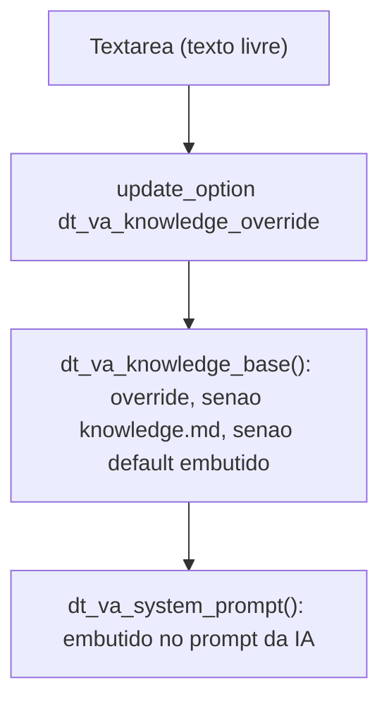
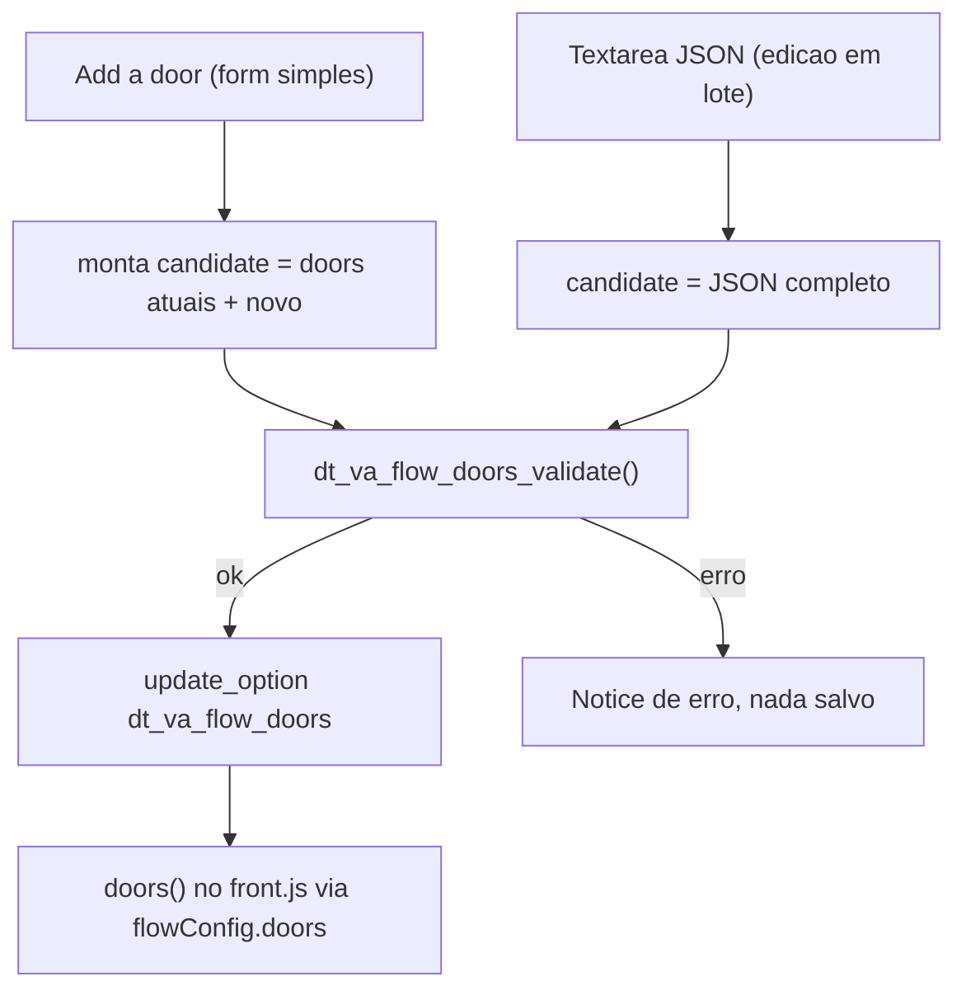
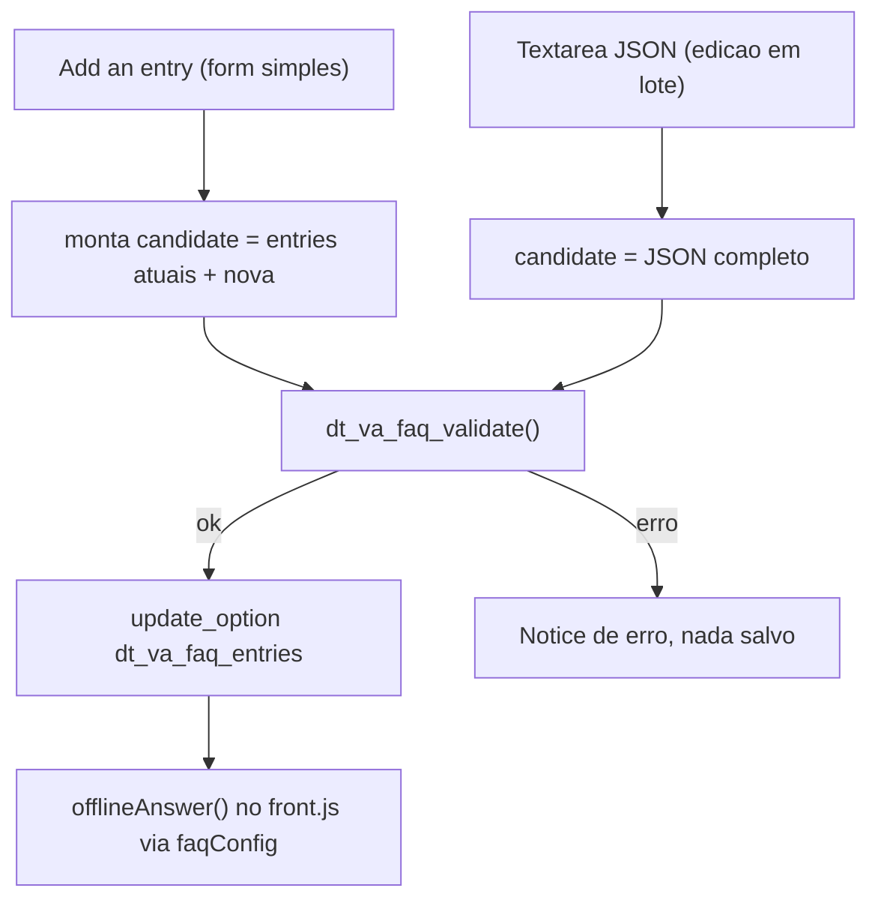

# Cadastro: Knowledge base, Doors e Offline FAQ

Os três seguem o mesmo padrão: um formulario grava uma opcao do WordPress depois de validar; em runtime, o front-end ou o system prompt usam essa opcao se ela existir, senao caem no comportamento padrao (hardcoded).

### Knowledge base (`dt-va/knowledge.php`)

### Doors (`dt-va/flow.php`)

### Offline FAQ (`dt-va/faq.php`)

- **Padrao comum**: "Add ..." (form simples) e textarea (JSON bruto) alimentam a MESMA funcao de validacao, entao nunca ha um caminho que aceite algo que o outro rejeitaria.
- **Restore default**: em todos os tres, apaga a opcao (`delete_option`) e volta ao comportamento padrao hardcoded, sem apagar arquivos.
- **Seguranca por design**: Doors valida `action`/`service` por formato (nunca free text executavel); Offline FAQ aceita so palavras/frases simples como keyword, nunca regex (evita ReDoS); Knowledge base e texto livre mas so alimenta o system prompt, nunca e executado.
