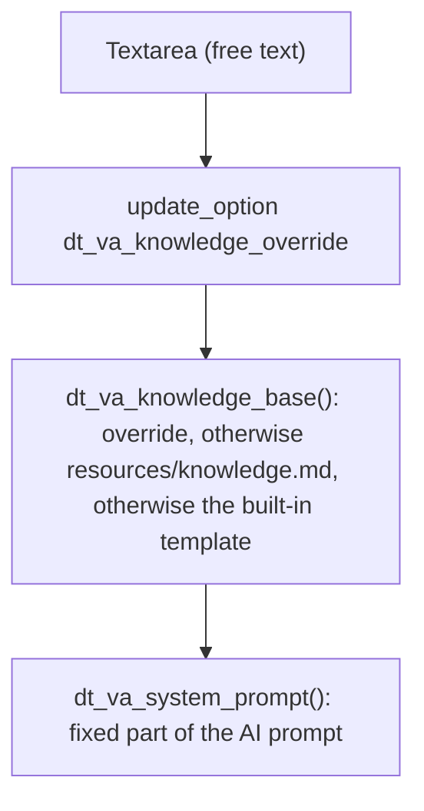
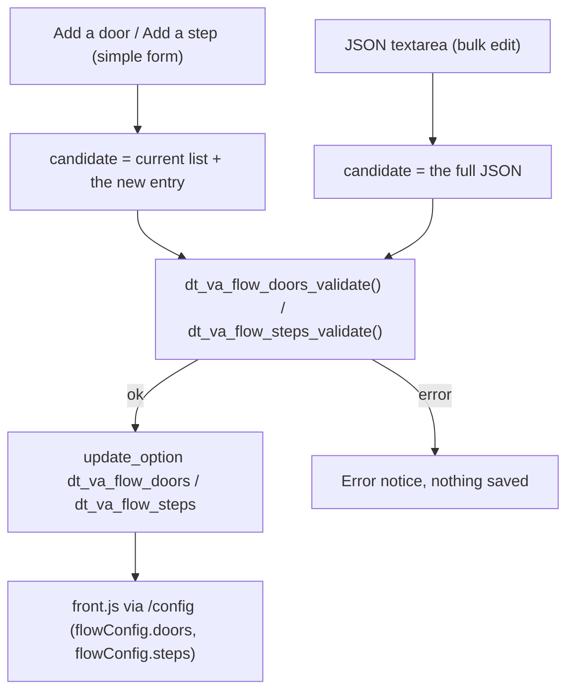
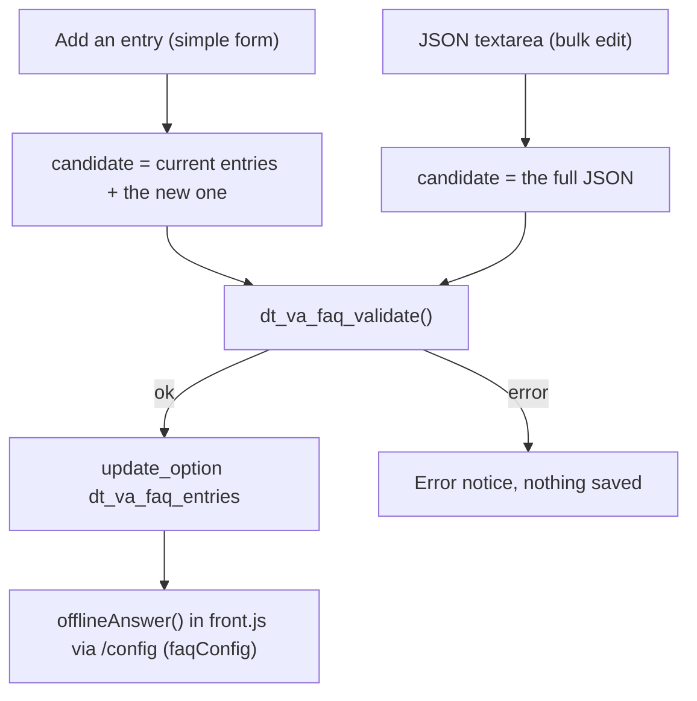

# Saving: Knowledge base, Doors and Offline FAQ

All three follow the same pattern: a form saves a WordPress option after validation; at runtime the front end or the system prompt uses that option when it exists, otherwise the built-in default.

### Knowledge base (`src/services/knowledge.php`)

### Doors and Step questions (`src/services/flow.php`)

### Offline FAQ (`src/services/faq.php`)

- **Common pattern:** the "Add …" form and the JSON textarea go through the same validation function, so neither path accepts what the other would refuse.
- **Restore default:** deletes the option (`delete_option`) and goes back to the built-in default; no file is touched.
- **Safe by design:** Doors validate `action` / `service` by format (never executable free text); Offline FAQ keywords are plain words or phrases, never regular expressions (no ReDoS); the Knowledge base is free text that only feeds the system prompt and is never executed.
