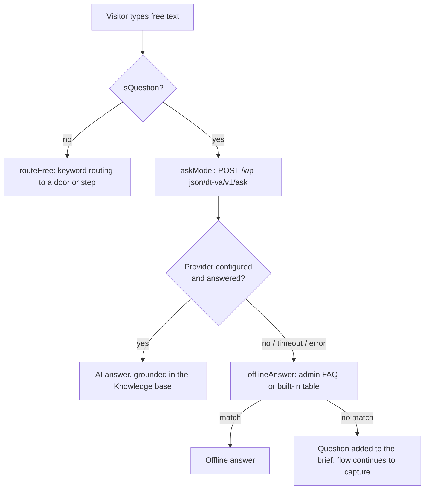

# When the AI is used

Doors and Step questions are a scripted flow that runs in the browser, with no network call and no AI. The AI (OpenAI or Anthropic) is only called when the visitor types a free-text question that passes `isQuestion()`. If the call fails, no provider is configured, it times out (`DT_VA_ASK_DEADLINE`, 15 s) or `fetch` is unavailable, the assistant falls back to the offline answers (the Offline FAQ saved in the admin, otherwise the built-in table in `offlineAnswer()`).

- **Doors / Step questions:** fixed flow, no AI (`goToStep()` / `runConfigStep()` in `front.js`).
- **Knowledge base:** only used inside the system prompt (`dt_va_system_prompt()`) when the AI is called. It is the fixed, cacheable part of the prompt; the service the visitor picked goes last.
- **Offline FAQ:** the safety net when the AI is down, has no key or times out, and a quick answer for short questions before the AI is asked.
