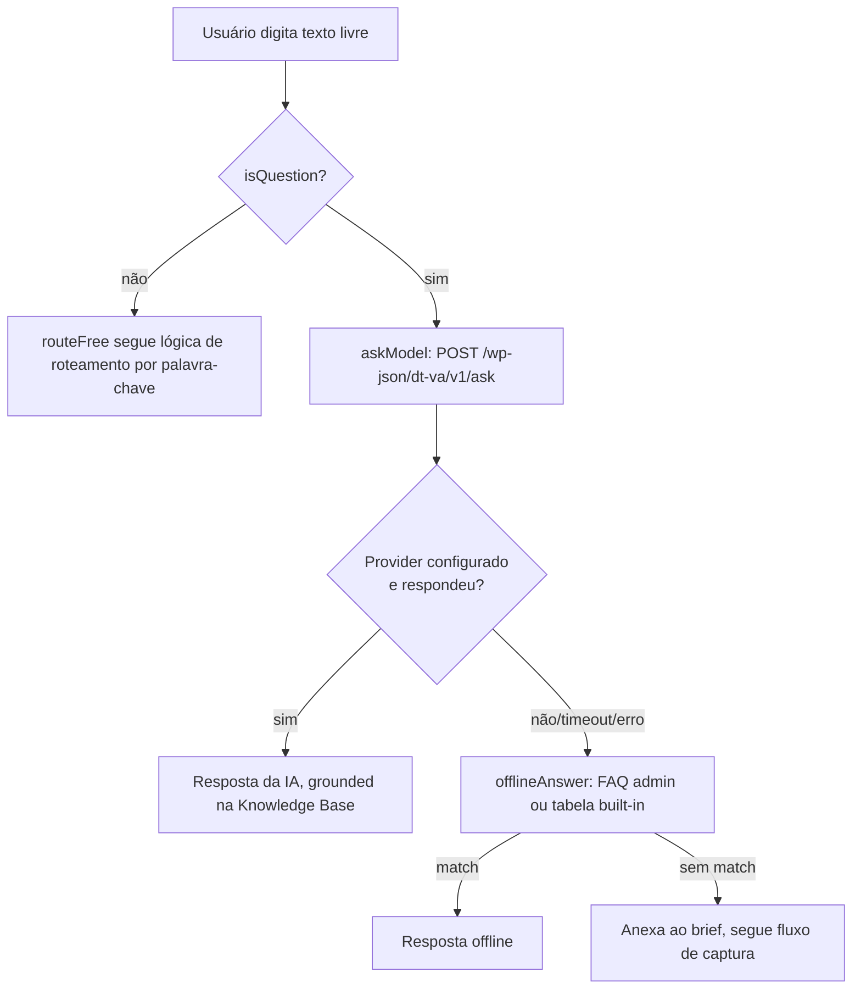

# Quando a IA entra em ação

Doors e Steps são um fluxo scriptado no cliente (sem rede, sem IA). A IA (OpenAI/Anthropic) só é chamada quando o visitante digita uma pergunta livre que passa em `isQuestion()`. Se a chamada falhar, faltar provider configurado, der timeout ou o `fetch` não estiver disponível, cai no fallback offline (FAQ configurada no admin, senão a tabela built-in de `offlineAnswer()`).

- **Doors/Steps**: fluxo fixo, sem IA (`goToStep()`/`runConfigStep()` em `front.js`).
- **Knowledge base**: usada só dentro do system prompt (`dt_va_system_prompt()`) quando a IA é chamada.
- **Offline FAQ**: rede de segurança quando a IA está fora do ar, sem chave, em timeout, ou como resposta rápida antes de decidir se vale chamar a IA.
