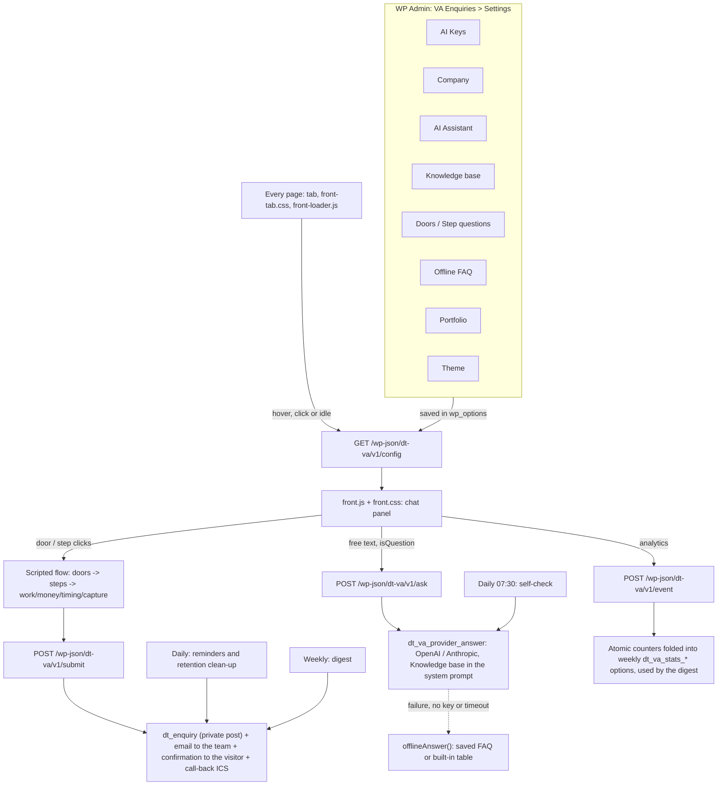

# How the module works

- **Admin:** each tab saves options in the database (`dt_va_*`); nothing requires editing code.
- **Loading:** every page gets only the tab, `front-tab.css` and `front-loader.js`. The loader fetches `/config` (doors, steps, FAQ, theme, public details, translations), `front.css` and `front.js` on the first interaction with the tab or once the page is idle.
- **Flow (doors / steps):** runs in the browser, with no network call, until `capture` sends `/submit`.
- **Ask:** only when the free text looks like a question; the AI answers only from the Knowledge base in the system prompt.
- **Submit:** always works (with or without AI): it creates the VA Enquiries record and sends the emails from an address on the site's domain.
- **Tokens:** `/ask`, `/submit` and `/event` need a visitor token from `GET /token` (signed, bound to the IP).
- **Scheduled events:** the daily self-check emails when the AI stops (or starts) answering; the daily run sends reminders for unanswered enquiries and deletes enquiries past the retention period; the weekly digest summarises enquiries, the funnel and the doors used.
