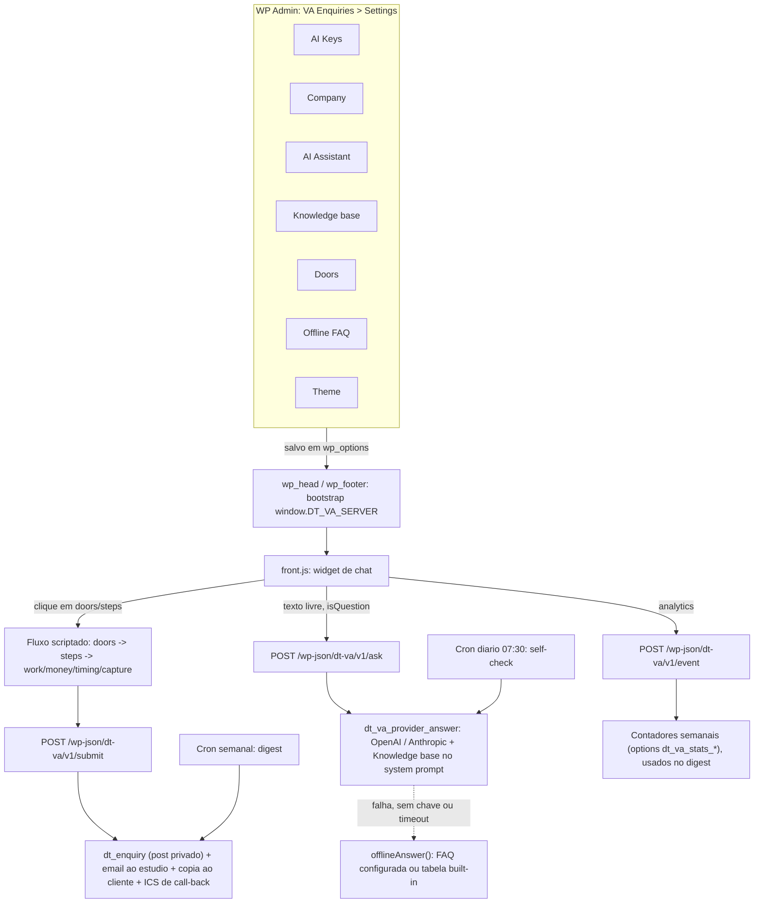

# Funcionamento geral do plugin

- **Admin**: cada aba grava opções no banco (`dt_va_*`); nada exige editar código.
- **Bootstrap**: `dt-va-server.php` monta `$cfg` (flowConfig, faqConfig, themeConfig, publicConfig) e injeta no HTML antes do `front.js` carregar.
- **Flow (doors/steps)**: 100% no cliente, sem rede, até chegar em `capture` e disparar `/submit`.
- **Ask**: só acionado quando o texto livre parece pergunta; a IA responde apenas com base na Knowledge base do system prompt.
- **Submit**: sempre roda (mesmo sem IA), gera o registro em VA Enquiries e os emails.
- **Crons**: self-check diário avisa se a IA parou de responder; digest semanal resume a semana (enquiries, funil, doors mais usados).
